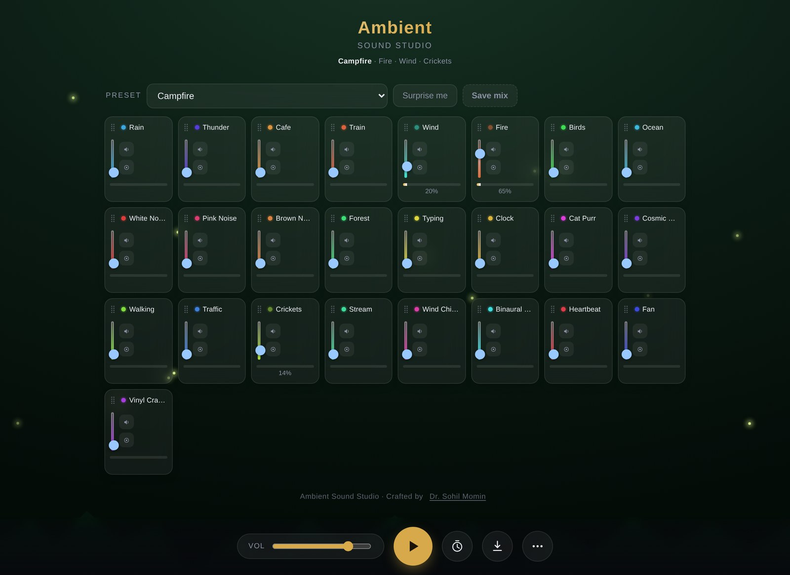
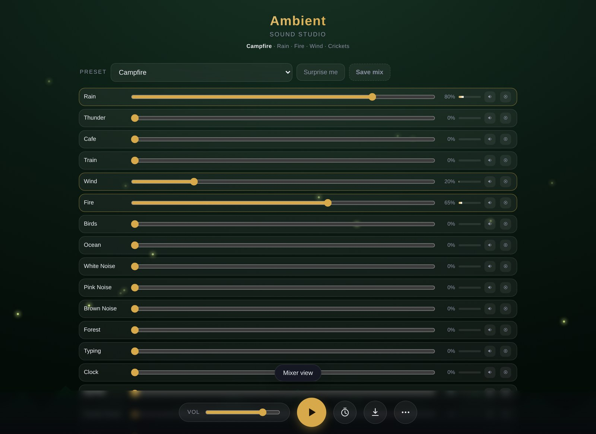
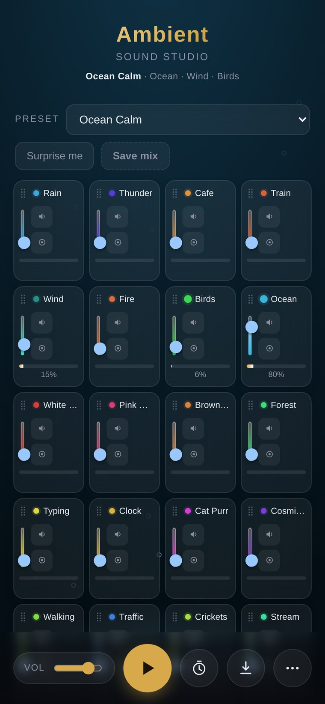

<div align="center">


# Ambient Sound Studio

**A private, offline ambient sound mixer that lives in a single HTML file.**

Layer rain, thunder, fire, café murmur, ocean, wind chimes and more — then export the mix as WAV or Opus.

[](LICENSE)
[](LICENSE)
[(CHANGELOG.md)
[](#-zero-dependencies)
[](#-offline--pwa)
[](#-zero-dependencies)
[](#-offline--pwa)
[](#-privacy)
[](#-zero-dependencies)

[](https://developer.mozilla.org/docs/Web/HTML)
[](https://developer.mozilla.org/docs/Web/API/Web_Audio_API)
[](#-the-sound-library)
[](#-presets)
[](#-languages)
[](#-development)
[](#credits)

[Quick start](#-quick-start) · [Features](#-features) · [Sounds](#-the-sound-library) · [Export](#-exporting) · [Offline & PWA](#-offline--pwa) · [Development](#-development) · [FAQ](docs/FAQ.md)

</div>

---

## 📸 Screenshots

<div align="center">

**Desktop — 25 layers, live level meters, mood themes**



<table>
<tr>
<td width="50%"><br><sub><b>Mixer view</b> — horizontal faders and meters</sub></td>
<td width="50%"><br><sub><b>Mobile</b> — responsive, installable as an app</sub></td>
</tr>
</table>

</div>

---

## ✨ Features

**Mixing**
- **25 synthesised layers** — rain, thunder, café, train, wind, fire, birds, ocean, white/pink/brown noise, forest, typing, clock, cat purr, cosmic drone, footsteps, traffic, crickets, stream, wind chimes, heartbeat, fan, vinyl crackle, binaural beat and microphone input
- Per-layer fader, **mute**, **solo**, **live level meter** and percentage readout
- **Automatic level calibration** — each layer is measured and levelled so nothing is too quiet or too loud
- **Reverb** with a Space control, plus master tone shaping
- **Ducking** — beds ease down under loud events
- **Binaural beats** (Delta / Theta / Alpha / Beta / Gamma) for focus and sleep
- **Breathing guide** with Box 4-4-4-4, Relax 4-7-8 and Calm 4-6 patterns
- **Card view and mixer view**, drag to reorder layers

**Presets & moods**
- **36 curated presets** across Sleep, Focus, Relax, Nature and Urban, with a category filter and search
- Each preset carries a matching **mood theme** that recolours the whole app
- **Surprise me** randomiser, save your own mixes, and share a mix as a link

**Export**
- **WAV** (16-bit or 24-bit, instant) and **Opus** (small, real Ogg Opus)
- Choose the fade length, up to 10 minutes, filenames that name the layers
- Exports are **peak-normalised** and built from multiple distinct crossfaded tiles, so nothing loops audibly
- Optional **pause playback while exporting** for a faster render

**Comfort & control**
- Session restore, **A/B compare**, **undo**, **Pomodoro**, sleep timer with gentle ramp-up
- Media Session (lock-screen controls) and screen Wake Lock
- Audio output picker, accent colour, haptics
- Full **keyboard control** and screen-reader-friendly markup
- **Three languages** — English, Hindi and Gujarati, switchable in the More menu
- **Sound packs** — export your own sounds plus the current mix as a single file, and import someone else's

---

## 🎼 The sound library

25 layers, every one synthesised in the browser — no audio files, no network.

| Layer | Character |
|---|---|
| **Rain** | Filtered hiss with individual droplet impacts and slow swells |
| **Thunder** | Distant rumble with crack-and-tail strikes |
| **Cafe** | Formant murmur with cup clinks and plate rattle |
| **Train** | Carriage rumble and rhythmic track clacks |
| **Wind** | Low-passed noise with a drifting gust filter |
| **Fire** | Brown-noise body with resonant crackle pops and whoomphs |
| **Birds** | Multi-note phrases with pitch glides |
| **Ocean** | Slow tidal swells on a deep bed |
| **White / Pink / Brown Noise** | The classic noise colours, seamlessly looped |
| **Forest** | Leafy mid-band bed with birdsong and rustle |
| **Typing** | Crisp keyboard clicks at an irregular pace |
| **Clock** | A steady tick and tock |
| **Cat Purr** | Low buzz with breath and a slow tremolo |
| **Cosmic Drone** | Slow beating low partials |
| **Footsteps** | Alternating footfalls |
| **Traffic** | Distant road hum with passing whooshes |
| **Crickets** | Chirruping pulses at a natural rhythm |
| **Stream** | Bubbling water with two drifting filters |
| **Wind Chimes** | **Modal synthesis** — inharmonic partials with individual decays |
| **Binaural Beat** | Different frequency per ear (Delta → Gamma); needs headphones |
| **Heartbeat** | A soft double thump |
| **Fan** | Steady broadband hum with a gentle rotation |
| **Vinyl Crackle** | Surface hiss, dense crackle and slow wobble |
| **Microphone** | Your live input, added on demand (never leaves the page) |

Plus **your own audio files**, which become layers of their own.

---

## 🗂 Presets

36 curated mixes across five categories. Each carries a matching mood theme.

| Category | Presets |
|---|---|
| 🌿 **Nature** | Cozy Rain · Thunderstorm · Forest Night · Country Walk · Riverside · Rain on Car · Summer Night · Rainforest · Campfire · Monsoon Evening · Dawn Chorus · Summer Afternoon |
| 🏙️ **Urban** | Busy Cafe · City Commute · Late Night Drive · Airport Lounge · Night Bus |
| 🎯 **Focus** | Deep Focus · Cozy Study · Library · Laundromat · Study Hall · Focus Beats · Exam Hall |
| 🛋️ **Relax** | Ocean Calm · Cat Cafe · Meditation · Seaside · Zen Garden · Rain on Window · Temple Bells · Spa |
| 🌙 **Sleep** | Deep Calm · Deep Sleep · Sleep Beats · Winter Night |

Filter by category or search by name in the app. **Surprise me** picks a random one.

---

## 🚀 Quick start

**The whole app is one file.** Download it and open it:

```bash
git clone https://github.com/drsamonline/ambient-sound-studio.git
cd ambient-sound-studio
open index.html          # macOS
# xdg-open index.html    # Linux
# start index.html       # Windows
```

That's it — no install, no build, no server, no network. Everything runs from your disk.

Prefer a link? Serve the folder with any static host (GitHub Pages, Netlify, `python3 -m http.server`) and open it in a browser.

> **First click starts audio.** Browsers require a user gesture before playing sound, so press the ▶ button (or a preset) to begin.

---

## 🎛 Using it

| Step | What to do |
|---|---|
| 1 | Tap a **preset** for an instant mood, or **Surprise me** for a random one |
| 2 | Raise individual **layer faders** to build your own mix |
| 3 | Use **mute** / **solo** to isolate layers, and watch the **meters** |
| 4 | Press **▶** to play; the **Sleep** timer and **Pomodoro** are in the dock |
| 5 | Open **⋯ (More)** for reverb, binaural beat, breathing, mixer view, sounds, extras and settings |
| 6 | **Export** from the download icon |

Double-tap any fader to reset it to zero. The bar under the title always shows the current mix and its layers.

### ⌨️ Keyboard shortcuts

| Key | Action |
|---|---|
| <kbd>Space</kbd> / <kbd>K</kbd> | Play or pause |
| <kbd>M</kbd> | Mute everything |
| <kbd>R</kbd> | Surprise me (random mix) |
| <kbd>S</kbd> | Silence all layers |
| <kbd>B</kbd> | Breathing guide |
| <kbd>V</kbd> | Toggle mixer view |
| <kbd>1</kbd>–<kbd>9</kbd> | Apply preset 1–9 |
| <kbd>Ctrl</kbd>/<kbd>⌘</kbd>+<kbd>Z</kbd> | Undo |
| <kbd>?</kbd> | Help |
| <kbd>Esc</kbd> | Close panels |
| <kbd>←</kbd> <kbd>→</kbd> <kbd>↑</kbd> <kbd>↓</kbd> | Move a layer, when its drag handle has focus |

---

## 🎚 Exporting

| Format | Speed | Notes |
|---|---|---|
| **WAV** 16-bit / 24-bit | Instant | Lossless. A 10-minute stereo file is ~115 MB (16-bit) or ~173 MB (24-bit). |
| **Opus** (Ogg) | Fast, not instant | Small and high quality. Needs a **one-time ~230 KB encoder download** (see below), then it is cached and reused offline forever. |

Exports are capped at **10 minutes**, peak-normalised, and assembled from several distinct crossfaded tiles so nothing audibly repeats. Playback pauses during the export (optional) and resumes afterwards.

> **About the Opus encoder.** The app asks before downloading it, tells you why, and stores it on your device. After that one download it works offline for good. If you decline, or you are offline, the app falls back to the browser's own recorder, or to WAV.

---

## 🎵 Your own sounds

**More ⋯ → Add sound files…** turns any audio file into a first-class layer: it gets a card, fader, mute, solo, meter and reverb send, and it is stored on your device and restored on every later visit. Remove one with the small × on its card.

This is also the honest answer to "can it ship with recorded samples": every **built-in** layer is synthesised in the browser (no audio files, no network), while recorded audio is whatever **you** add.

---

## 📴 Offline & PWA

- **Every built-in sound is generated in the browser** — there are no audio files and no network requests. Open the file with the network switched off and it works completely.
- The app ships a full **web app manifest**, maskable icons and an **Install app** button, so it installs to your home screen and opens without browser chrome.
- **iOS installs it as-is.** For Chrome/Edge/Android to offer a full install prompt, host the folder and make sure `sw.js` (included in this repo) sits next to `index.html` — the app registers it automatically when served over http(s).

---

## 🔒 Privacy

- **No analytics, no telemetry, no accounts, no cloud.** Nothing is ever uploaded.
- Everything you create — mixes, custom sounds, the cached encoder — is stored **on your own device**.
- The only network request the app can ever make is the **optional, user-confirmed** Opus encoder download.
- Microphone access is only requested if you explicitly turn on the microphone layer, and that audio never leaves the page.

---

## 🧩 Zero dependencies

- **One HTML file.** HTML, CSS and JavaScript in a single document.
- **No framework, no build step required, no CDN** for the app itself.
- The minified build is **96 KB**; the readable source is 116 KB.
- Third-party code is limited to the optional Opus encoder, downloaded at your request and cached locally — see [docs/THIRD-PARTY.md](docs/THIRD-PARTY.md).

---

## 🌐 Browser support

| Browser | Playback | WAV export | Opus export |
|---|---|---|---|
| Chrome / Edge / Brave | ✅ | ✅ | ✅ (Ogg) |
| Firefox | ✅ | ✅ | ✅ (Ogg) |
| Safari (macOS / iOS) | ✅ | ✅ | ✅ (Ogg) — requires the encoder download |
| Any browser without Web Audio | ❌ | — | — |

Requires the **Web Audio API** (every current browser). The app detects its absence and shows a clear message instead of failing silently.

---

## 📁 Project layout

```
ambient-sound-studio/
├── index.html                      ← the app (minified, ready to serve)
├── sw.js                           ← optional service worker for a full PWA install
├── src/
│   └── ambient-sound-studio.src.html   ← readable source (edit this one)
├── assets/                         ← banner + screenshots used by this README
├── docs/
│   ├── ARCHITECTURE.md             ← how the audio engine and app fit together
│   ├── BUILD.md                    ← regenerating the minified build
│   ├── FAQ.md                      ← common questions
│   └── THIRD-PARTY.md              ← third-party components and licences
├── tools/
│   └── build.js                    ← the minifier
├── .github/                        ← issue templates, PR template, Pages workflow
├── CHANGELOG.md
├── CONTRIBUTING.md
├── CODE_OF_CONDUCT.md
├── SECURITY.md
└── LICENSE
```

---

## 🛠 Development

You can edit the app with nothing but a text editor — **`src/ambient-sound-studio.src.html` is the source of truth**, and it runs directly in a browser.

To rebuild the minified `index.html`:

```bash
npm install            # installs html-minifier-terser (dev only)
npm run build          # writes index.html from src/
```

The build is optional. There is no framework, no bundler, no transpiler and no test dependency — the app is plain HTML, CSS and JavaScript, and it is meant to stay that way.

See [docs/ARCHITECTURE.md](docs/ARCHITECTURE.md) for a guided tour of the code and [CONTRIBUTING.md](CONTRIBUTING.md) before opening a pull request.

---

## 🗺 Roadmap

- [x] 25 layers, 36 presets, reverb, binaural beats, ducking
- [x] WAV + Opus export with multi-tile crossfading
- [x] Fully offline, installable PWA
- [x] Your own audio files as layers
- [x] **Sound packs** — export your custom sounds + mix as one shareable file
- [x] **Seasonal and regional presets** — Monsoon Evening, Dawn Chorus, Winter Night, Temple Bells…
- [x] **Localisation** — English, Hindi and Gujarati

More ideas are welcome — see [CONTRIBUTING.md](CONTRIBUTING.md).

---

## 📄 Licence

**Free for personal, non-commercial use. Commercial use requires permission and a licence from the author.**

| Use | Allowed? |
|---|---|
| Personal use at home | ✅ Free |
| Study, modify, tinker | ✅ Free |
| Share with others, free of charge | ✅ Free, with this licence kept intact |
| Use at work, or for a client | ❌ Requires a commercial licence |
| Sell it, bundle it, or host it commercially | ❌ Requires a commercial licence |
| Use in an ad-supported or monetised product | ❌ Requires a commercial licence |

See [LICENSE](LICENSE) for the full terms. To request a commercial licence, contact the author through the contact details on their GitHub profile.

> **Please note:** because commercial use is restricted, this is a **source-available** licence, not an OSI-approved open-source licence. Third-party components the app downloads are governed by their own (permissive) licences — see [docs/THIRD-PARTY.md](docs/THIRD-PARTY.md).

---

## Credits

Built by **[Dr. Sohil Momin](https://github.com/)** — physician, hospital administrator and medical teacher in Vadodara, India, who builds small tools like this as a side interest.

Sounds are synthesised from filtered noise, oscillators and modal partials — no recordings are bundled.

<div align="center">
<sub>If this helps you sleep, focus or unwind, a ⭐ on the repo is appreciated.</sub>
</div>
